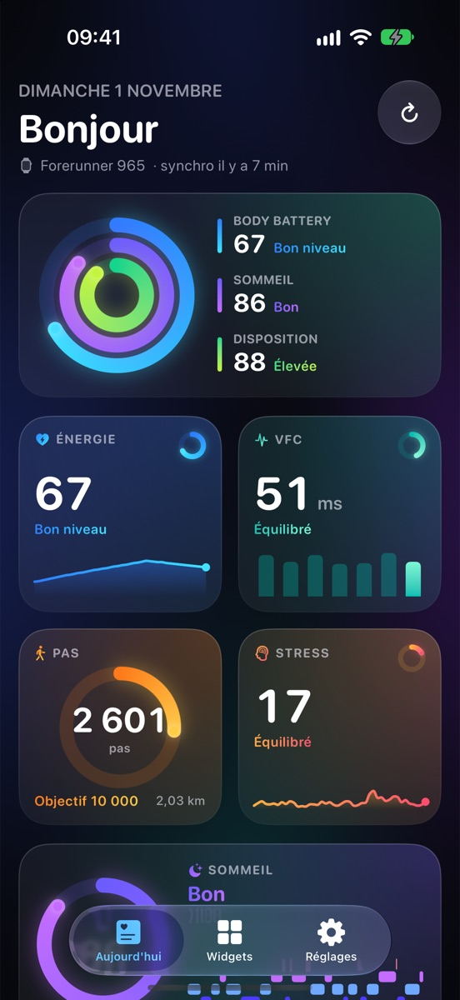
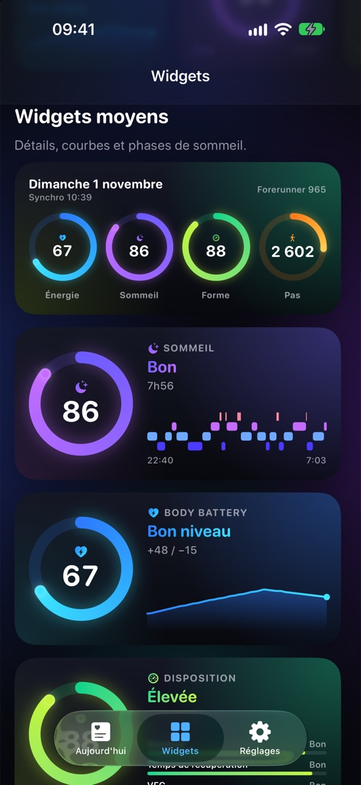
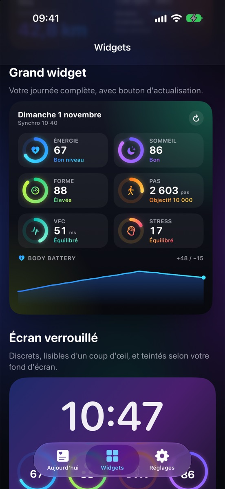
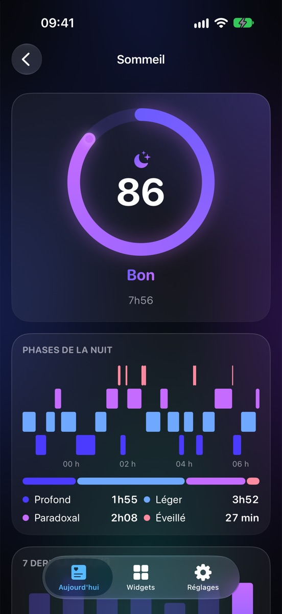

<p align="center">
  
</p>

<h1 align="center">Health Widgets</h1>

<p align="center">
  Beautiful iOS widgets for your sports-watch data: Body Battery, sleep, HRV, training
  readiness, steps, stress, heart rate, VO₂ max, last workout…<br>
  <b>Garmin today</b>, more providers to come. Self-hosted, private, open source.
</p>

<p align="center">
  
  
  
  
</p>

## How it works

```
iPhone (app + widgets)  ──HTTPS──▶  your Health Widgets server  ──▶  Garmin Connect
                                    (one Docker container)
```

The app never talks to Garmin directly. A small server that you run yourself signs in to
Garmin Connect with [python-garminconnect](https://github.com/cyberjunky/python-garminconnect)
and serves a clean daily summary that the app and its widgets display.

Why a server? python-garminconnect is the reference Garmin client and is actively
maintained, but it is written in Python and can't run inside an iOS app or a widget.
Keeping it on the server also means that when Garmin changes its login, you update a
Docker image, not the app.

## Install

**You need:** a Mac with Xcode 27+, an iPhone on iOS 26+, an Apple Developer account,
and a machine with Docker that stays on (NAS, mini-PC, Raspberry Pi, VPS…).

### 1. Start the server

```bash
git clone https://github.com/cldt-fr/health-widgets-ios.git
cd health-widgets-ios/backend
docker compose up -d
docker compose logs api | grep "Signup code"
```

Write down the signup code (like `k7f2-q9xm-3hwd`). The app asks for it once, and it
keeps strangers from using your server. The server listens on port `8000`.

### 2. Install the app

```bash
cd ..   # back to the repository root
cp Config/Local.example.xcconfig Config/Local.xcconfig
```

In `Config/Local.xcconfig`, set your **Team ID** (Xcode › Settings › Accounts) and a
**bundle identifier** of your own, such as `com.yourname.healthwidgets`. Then open
`Health Widgets.xcodeproj`, select your iPhone and press **Run**.

> The widgets read the app's data through an App Group. If Xcode refuses that capability
> on a free personal team, sign with a paid Apple Developer account.

### 3. Connect your watch

1. In the app, tap **Connecter ma montre**, then **Garmin**.
2. Enter your server address, such as `http://192.168.1.20:8000`, and the signup code.
3. Sign in with your Garmin email and password. If two-step verification is on, type the
   code Garmin sends you.
4. Long-press your Home Screen › **Edit** › **Add Widget** › **Health Widgets**.

### Optional: use it away from home

Over Wi-Fi at home, the iPhone reaches the server directly. For widgets that update
everywhere, publish the server over HTTPS, for example with
[Cloudflare Tunnel](https://developers.cloudflare.com/cloudflare-one/connections/connect-networks/),
[Tailscale Funnel](https://tailscale.com/kb/1223/funnel) or a reverse proxy such as
[Caddy](https://caddyserver.com), and use the `https://` address in the app.

### No watch? Try the demo

On the welcome screen, **Explorer avec des données de démo** runs entirely on the iPhone.
It also works in the Simulator, without an Apple Developer account.

## Widgets

| Widget | Sizes | What it shows |
|---|---|---|
| **Metric** (configurable) | small, medium, Lock Screen (circular, rectangular, inline) | One metric: gradient ring, today's curve or 7-day history, sleep stages, readiness factors |
| **My day** | medium, large | Body Battery, sleep, readiness and steps as rings. The large size adds 6 tiles, the Body Battery curve and a refresh button |
| **Last workout** | small, medium | Distance, duration, pace or speed, heart rate, aerobic and anaerobic training effect |

Widgets refresh about every 30 minutes (iOS decides the exact timing), work while the
iPhone is locked, adapt to tinted and Lock Screen rendering, and open the matching screen
when tapped. The app's **Widgets** tab previews all of them with your own data.

## Privacy and security

- Your Garmin password goes to your server once, to obtain access tokens. It is never
  stored, neither on the iPhone nor on the server.
- Garmin tokens and cached data are encrypted at rest. Each iPhone gets its own random
  device token, and the server only stores its hash.
- Data only flows between your iPhone, your server and Garmin: no analytics, no third
  party.
- **Réglages › Supprimer mon compte et mes données** deletes everything from the server.

## Update

```bash
git pull
cd backend && docker compose up -d --build
```

`git pull` brings the latest server code, including python-garminconnect updates pinned in
`backend/uv.lock`. To try a newer python-garminconnect release before it lands here:
`uv lock --upgrade-package garminconnect`, then rebuild. See
[backend/README.md](backend/README.md) for the server options (`.env`), the API and
deployment tips.

## Development

- **Server**: `cd backend && uv sync && HW_OPEN_REGISTRATION=true HW_ENABLE_DEMO_PROVIDER=true uv run healthwidgets-server --reload`.
  The Simulator reaches it at `http://localhost:8000`. Tests: `uv run pytest`.
- **App**: the Simulator needs no Apple account. Debug launch arguments:

  | Argument | Effect |
  |---|---|
  | `-demo` | Start in demo mode |
  | `-tab widgets` / `-tab settings` | Open a tab |
  | `-metric sleep` | Open a metric's detail |
  | `-scrollTo medium` | Scroll to a section (`medium`, `large`, `lock`, `sleep`, `activity`) |
  | `-onboarding` | Show the welcome screen |
  | `-e2e-server http://localhost:8000` | Register on a local server (with `HW_OPEN_REGISTRATION=true` and `HW_ENABLE_DEMO_PROVIDER=true`), connect its demo provider and open the dashboard |

- **Layout**:

  ```
  Health Widgets/   iOS app: onboarding, dashboard, details, widget gallery, settings
  Widgets/          WidgetKit extension: widget configurations and timelines
  Shared/           Compiled into both targets: API models, networking, storage,
                    design system (rings, charts), widget views
  Config/           Build identity (Team ID, bundle ID, App Group) via xcconfig
  backend/          FastAPI server + python-garminconnect
  ```

  The data contract lives in `backend/src/healthwidgets/schemas.py` and is mirrored in
  `Shared/Model/Snapshot.swift`.

- **New provider** (Polar, COROS, Suunto…): add a module in `backend/src/healthwidgets/providers/`
  that maps the provider's data to the same snapshot, then enable it in
  `Shared/Model/AccountModels.swift`. Contributions are welcome!

## Notes

- **Unofficial.** python-garminconnect uses the same private API as the Garmin Connect app.
  This project is not affiliated with Garmin. A public App Store release would need
  Garmin's official [Connect Developer Program](https://developer.garmin.com/gc-developer-program/).
- **Not medical advice.** Metrics are the ones computed by Garmin.
- The app's interface is in French for now. Translations are welcome.

## Credits

- [python-garminconnect](https://github.com/cyberjunky/python-garminconnect) by Ron
  Klinkien (cyberjunky), MIT.

## License

[MIT](LICENSE)
